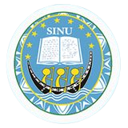

## Aims

MELANOBS is an observatory that tracks the response of Melanesian forests to global change, using permanent plots re-measured over time.

[Add the network's main aims here.]

## Partners

MELANOBS brings together partners from a range of backgrounds: research and academic institutions (the AMAP joint research unit, Solomon Islands National University, the University of the South Pacific, Adelaide University and the New York Botanical Garden), NGOs (Endemia and NatureFiji-MareqetiViti) and government agencies (the Solomon Islands Ministry of Forestry and Research, the Vanuatu Department of Forests, the Fiji Ministry of Fisheries and Forestry and, in New Caledonia, the Environment Department of the Loyalty Islands Province and the Protected Areas Management Department of the South Province). Among them are the curators of the region's [herbaria](herbaria.qmd).

::: {.partner-logos}

[{.logo-wide}](https://adelaide.edu.au)
[{.logo-wide}](https://www.nybg.org)
[{.logo-xwide}](https://endemia.nc)

:::

## Funders

The first phase of MELANOBS was funded by the French National Research Institute for Sustainable Development ([IRD](https://en.ird.fr)) and by the French Ministry for Europe and Foreign Affairs (MEAE), through the Pacific Fund for regional cooperation.

The establishment and resurveys of the plots in New Caledonia were also supported by the French National Research Agency ([ANR](https://anr.fr)) through the PEPR FORESTT programme (MONITOR project).

::: {.funder-logos}

[{.logo-wide}](https://anr.fr)

:::
