## Melanesia

::: {.about-photo}
 permanent plot, Solomon Islands. Photo: Ghislain Vieilledent](images/terminalia-poitete.webp){fig-alt="Looking up the tall, straight trunk of a Terminalia calamansanai tree in the rainforest, with a person resting a hand on it."}
:::

Melanesia is a geographic and cultural subregion of the southwest Pacific, made up of thousands of islands lying between the equator and the Tropic of Capricorn. From northwest to southeast, it includes the Indonesian provinces of western New Guinea, the independent states of Papua New Guinea, Solomon Islands, Vanuatu and Fiji, and the French territory of New Caledonia.

Forests cover more than three-quarters of the land in Melanesia. They support a unique biodiversity and help mitigate global warming by storing carbon. They are also essential to the well-being of local people, particularly in rural areas, through the many ecosystem services they provide. In the context of global change, these forests face multiple threats, including conversion to agricultural land, logging, mining, fires, cyclones, invasive species and climate change. Despite their importance and potential vulnerability, they remain relatively little studied.

The local scientific community working on the ecology and conservation of Melanesian forests is small and geographically dispersed. Researchers and experts often work in isolation, with little exchange between countries, even though they face similar problems: managing the effects of global change in island environments, with limited staff and expertise to meet conservation challenges.

## Aims

MELANOBS, the Melanesian Observatory of forest responses to global change, is a regional response to these challenges, combining collaboration and research to support forest conservation for the benefit of Melanesian communities. The project aims to build an international network of researchers and experts working on the ecology and conservation of Melanesian forests, based on collaboration, capacity building and equity.

More specifically, it seeks to:

- build capacity through research partnerships;
- improve knowledge of forest biodiversity, for example by establishing species checklists at the island level;
- improve knowledge of forest functioning, for example by monitoring tree demography (growth, mortality and recruitment).

The project rests on two pillars: establishing and maintaining a network of [permanent forest plots](plots.qmd), and strengthening collaboration between the [herbaria](herbaria.qmd) of the region.

## Partners

MELANOBS brings together partners from a range of backgrounds: research and academic institutions (the AMAP lab, Solomon Islands National University, the University of the South Pacific, Adelaide University and the New York Botanical Garden), NGOs (Endemia, NatureFiji-MareqetiViti and the New Guinea Binatang Research Center) and government agencies (the PNG Forest Research Institute, the Solomon Islands Ministry of Forestry and Research, the Vanuatu Department of Forestry, the Fiji Ministry of Fisheries and Forestry and, in New Caledonia, the Environment Department of the Loyalty Islands Province and the Protected Areas Management Department of the South Province). Among them are the curators of the region's [herbaria](herbaria.qmd).

![MELANOBS partners at the project kick-off workshop in New Caledonia (April 2024). From left to right: Presley Dovo (Department of Forestry, Vanuatu), Mereia Tabua (NatureFiji-MareqetiViti, Fiji), Marika Tuiwawa (University of the South Pacific, Fiji), Ghislain Vieilledent (CIRAD, AMAP lab, New Caledonia), David Bruy (IRD, AMAP lab, New Caledonia), Alivereti Naikatini (Ministry of Forestry, Fiji), Gunnar Keppel (Adelaide University, Australia), Willie Lore (Department of Forestry, Vanuatu), Patrick Nimiago (PNG Forest Research Institute, Papua New Guinea), Thomas Ibanez (IRD, AMAP lab, New Caledonia), Eric Katovai (Solomon Islands National University), Pagi Toko (Binatang Research Center, Papua New Guinea), Myknee Sirikolo (Ministry of Forestry and Research, Solomon Islands). Photo: Gregory Plunkett](images/partners-workshop-2024.jpg){.partners-photo fig-alt="Group photo of thirteen MELANOBS partners standing on a wooden deck in front of a forest park building."}

::: {.partner-logos}
[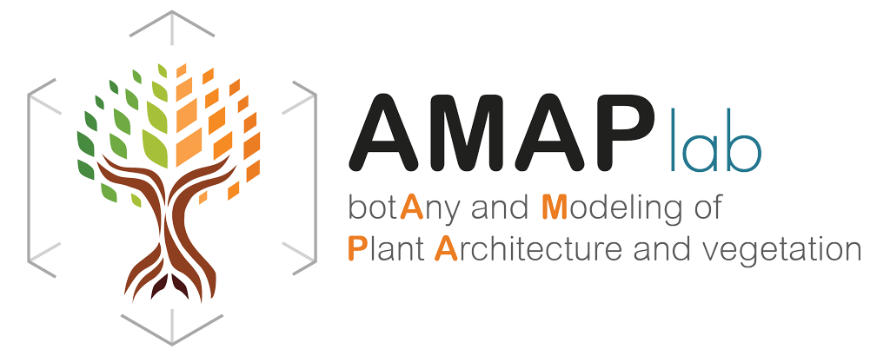{.no-lightbox}](https://amaplab.fr)
[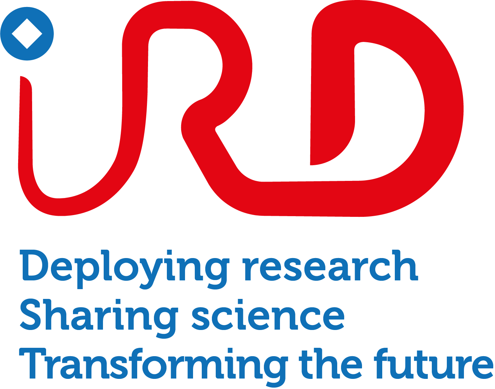{.no-lightbox}](https://en.ird.fr)
[{.logo-medium .no-lightbox}](https://www.sinu.edu.sb)
[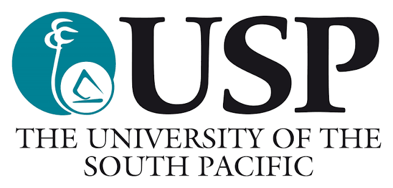{.no-lightbox}](https://www.usp.ac.fj)
[{.logo-wide .no-lightbox}](https://adelaide.edu.au)
[{.logo-wide .no-lightbox}](https://www.nybg.org)
[{.logo-xwide .no-lightbox}](https://endemia.nc)
[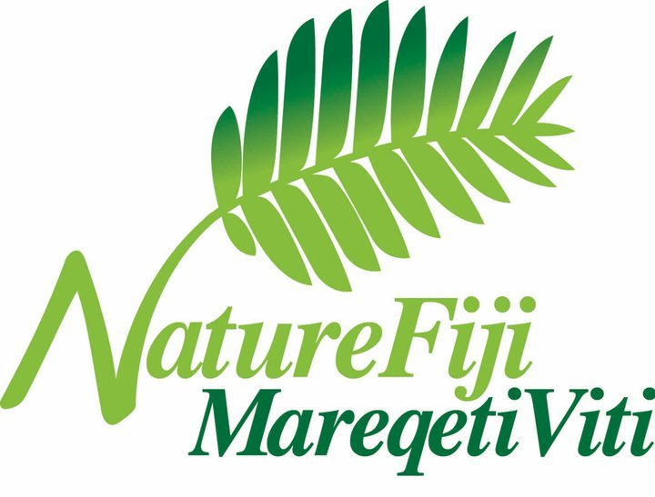{.no-lightbox}](https://www.naturefiji.org)
[{.logo-wide .no-lightbox}](https://www.ngbinatang.com)
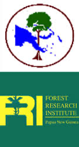{.logo-tall .no-lightbox}
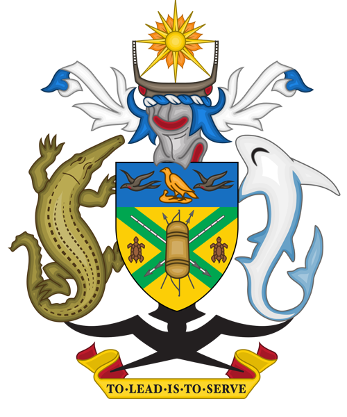{.no-lightbox}
[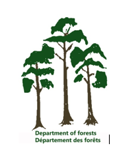{.no-lightbox}](https://malffb.gov.vu)
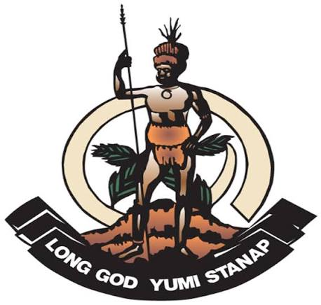{.no-lightbox}
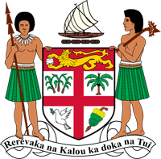{.no-lightbox}
[{.no-lightbox}](https://www.province-iles.nc)
[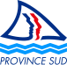{.no-lightbox}](https://www.province-sud.nc)
:::

## Funders

The first phase of MELANOBS was funded by the French National Research Institute for Sustainable Development ([IRD](https://en.ird.fr)) and by the French Ministry for Europe and Foreign Affairs (MEAE), through the Pacific Fund for regional cooperation.

The establishment and resurveys of the plots in New Caledonia were also supported by the French National Research Agency ([ANR](https://anr.fr)) through the PEPR FORESTT programme (MONITOR project).

::: {.funder-logos}
[{.no-lightbox}](https://en.ird.fr)
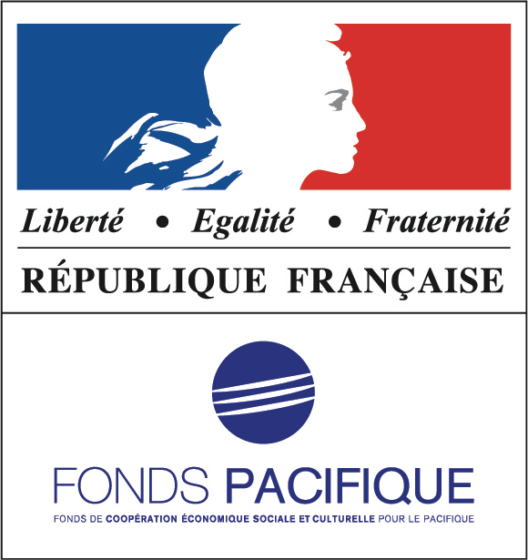{.no-lightbox}
[{.logo-wide .no-lightbox}](https://anr.fr)
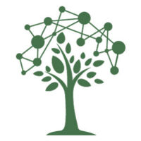{.no-lightbox}
:::
