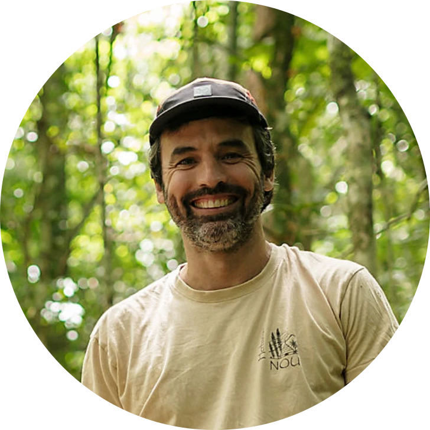

## Coordinator

::: {.contact-photo}
{fig-alt="Portrait of Thomas Ibanez in the forest."}
:::

MELANOBS is coordinated by **[Thomas Ibanez](https://scholar.google.com/citations?user=zlWMNqUAAAAJ)**, a research fellow at the [French National Research Institute for Sustainable Development](https://en.ird.fr) (IRD) and a member of the [AMAP lab](https://amaplab.fr). He is based in Nouméa, New Caledonia.

Thomas is a vegetation ecologist whose main interest is to understand how tree communities are shaped in tropical island forests and how they respond to global change. He works mostly in New Caledonia and across Melanesia. Within MELANOBS, he coordinates the regional network of partners and leads the permanent plots in New Caledonia.

**Email:** [thomas.ibanez@ird.fr](mailto:thomas.ibanez@ird.fr)

## Local principal investigators

Each permanent plot is led by a local principal investigator, who is the best contact for questions about the plot or the network in their country. Their contact details will be listed here soon.
