<!-- To add an item, copy a block below and paste it at the top of the list (newest first). The photo line is optional. -->

::: {.news-item}
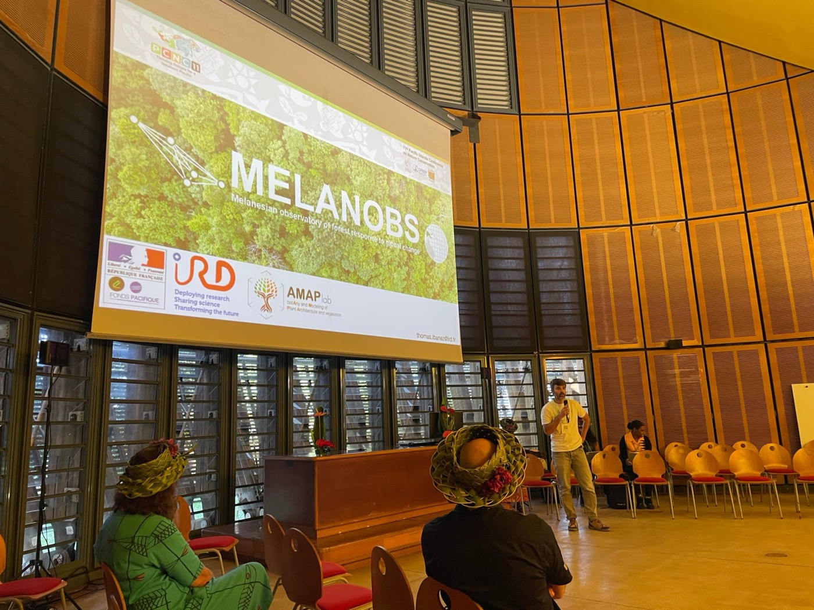{fig-alt="Thomas Ibanez speaking in a conference hall in front of a large screen showing the MELANOBS title slide."}

::: {.news-text}
[September 2026]{.news-date}

### MELANOBS presented at the 11th Pacific Islands Conference on Nature Conservation

Thomas Ibanez presented the MELANOBS project during a Species Working Group session of the 11th Pacific Islands Conference on Nature Conservation and Protected Areas, held at the Tjibaou Cultural Centre in Nouméa, New Caledonia (7–11 September 2026).
:::
:::

::: {.news-item}
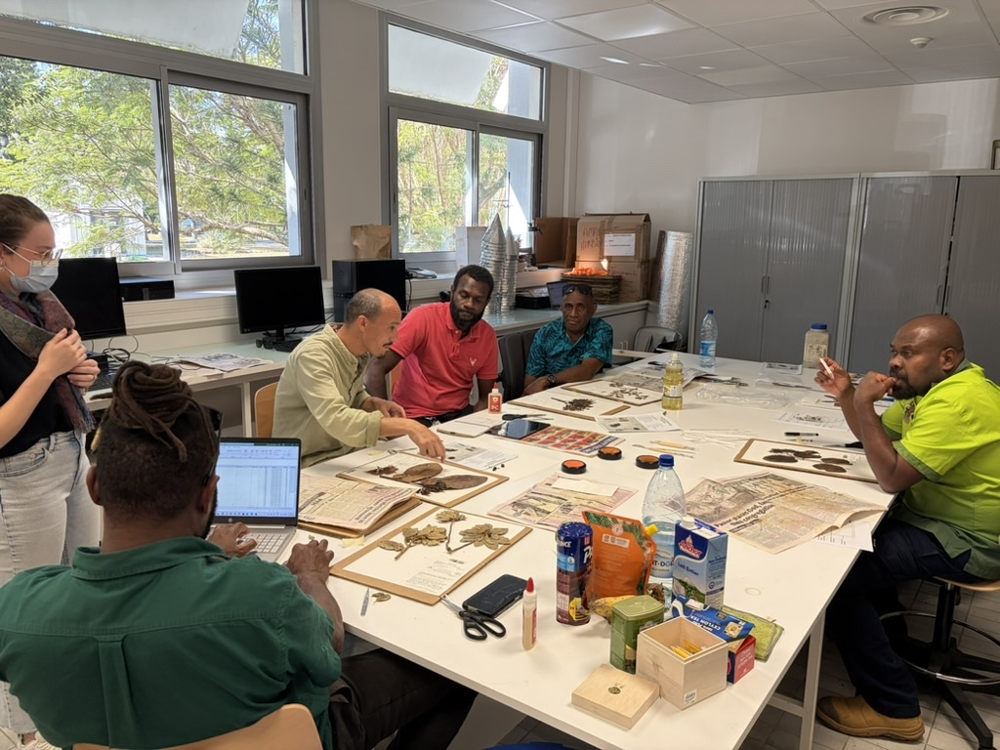{fig-alt="People around a table mounting dried plant specimens on herbarium sheets."}

::: {.news-text}
[September 2026]{.news-date}

### Vanuatu National Herbarium team trained in Nouméa

The team of the [Vanuatu National Herbarium](herbaria/pvnh.qmd) (PVNH) spent a week in Nouméa for herbarium management training. They also took part in the resurvey of the [Great Ferns Provincial Park](plots/great-ferns.qmd) plot, and are now ready to resurvey the [Nusumetu](plots/nusumetu.qmd) plot back in Vanuatu.
:::
:::

::: {.news-item}
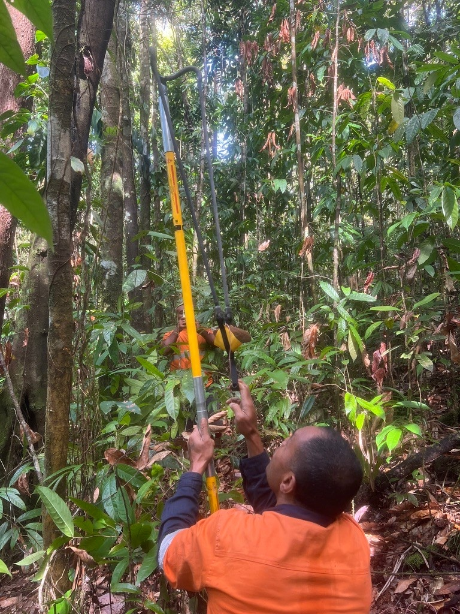{fig-alt="Field team member using a long pole pruner to collect a specimen from a tree in the forest."}

::: {.news-text}
[July 2026]{.news-date}

### New permanent plot at Vago, Fiji

The MELANOBS team, together with the Fiji Ministry of Forestry and the University of the South Pacific, set up a new 1-ha permanent forest plot at Vago, on the island of Viti Levu, Fiji. See the [Vago plot page](plots/vago.qmd).
:::
:::

::: {.news-item}
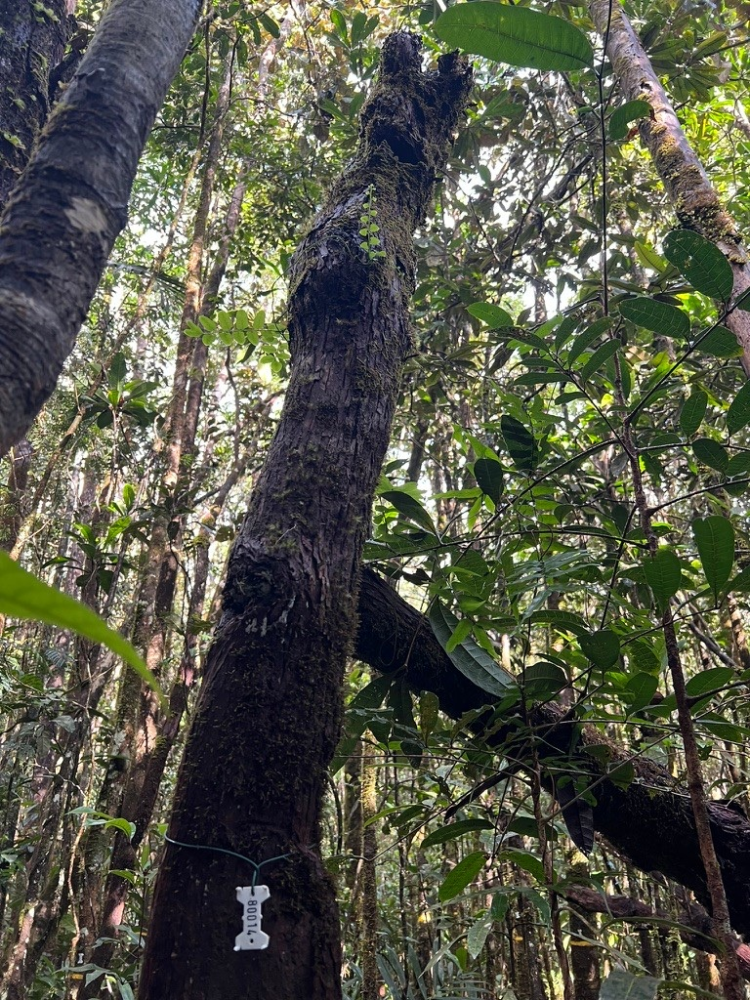{fig-alt="A tagged tree trunk rising into the forest canopy, seen from below."}

::: {.news-text}
[March 2026]{.news-date}

### First resurvey of the Blue River Provincial Park plot

The MELANOBS team completed the first resurvey of the [Blue River Provincial Park plot](plots/blue-river.qmd), one year after it was set up. Trees grew slowly overall, except in and around the large gap.
:::
:::

::: {.news-item}
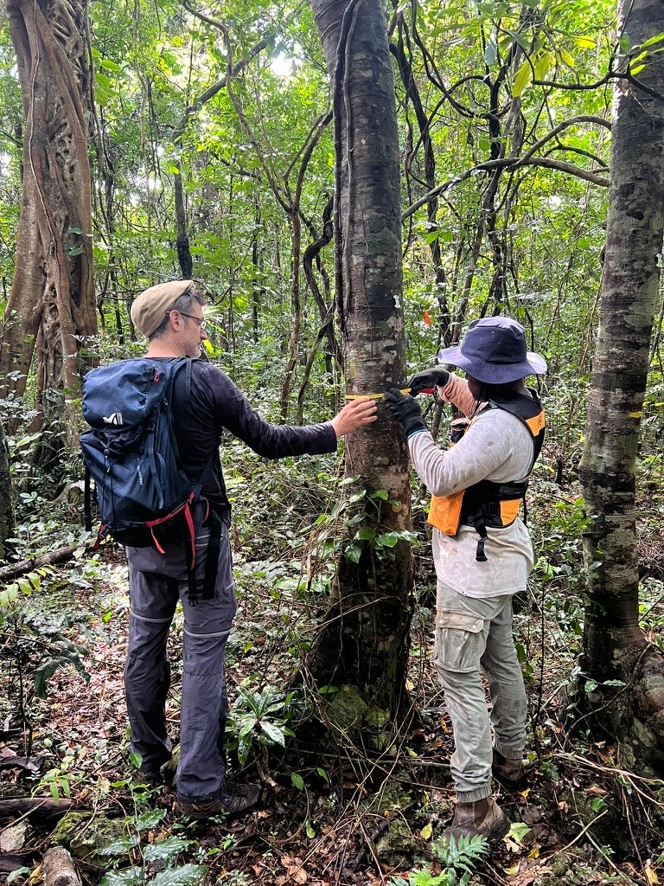{fig-alt="Two people measuring the diameter of a tree trunk with a tape in the forest."}

::: {.news-text}
[December 2025]{.news-date}

### First resurvey of the Siloam plot

The MELANOBS team completed the first resurvey of the [Siloam plot](plots/siloam.qmd), one year after it was set up. Trees grew very slowly.
:::
:::

::: {.news-item}
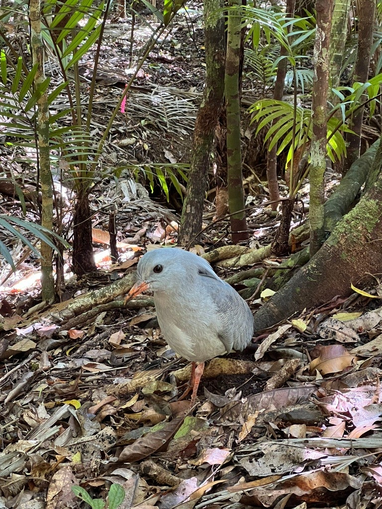{fig-alt="A grey kagu bird standing on the forest floor among leaf litter."}

::: {.news-text}
[September 2025]{.news-date}

### New permanent plot at Great Ferns, New Caledonia

The MELANOBS team set up a new 1-ha permanent forest plot in the Great Ferns Provincial Park, on the island of Grande Terre, New Caledonia. Kagus (*Rhynochetos jubatus*) joined the party! See the [Great Ferns Provincial Park plot page](plots/great-ferns.qmd).
:::
:::

::: {.news-item}
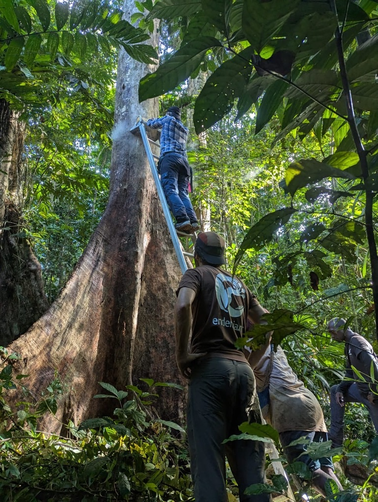{fig-alt="Team members at the base of a large buttressed tree, one on a ladder measuring the trunk."}

::: {.news-text}
[May 2025]{.news-date}

### New permanent plot at Poitete, Solomon Islands

The MELANOBS team, together with Solomon Islands National University and the Solomon Islands Ministry of Forestry and Research, set up a new 1-ha permanent forest plot at Poitete, on the island of Kolombangara, Solomon Islands. See the [Poitete plot page](plots/poitete.qmd).
:::
:::

::: {.news-item}
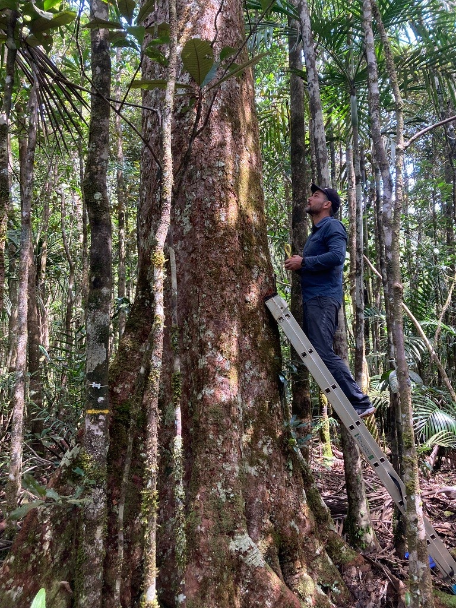{fig-alt="A person on a ladder measuring the trunk of a large tree in a forest with palms."}

::: {.news-text}
[March 2025]{.news-date}

### New permanent plot at Blue River, New Caledonia

The MELANOBS team set up a new 1-ha permanent forest plot in the Blue River Provincial Park, on the island of Grande Terre, New Caledonia. See the [Blue River Provincial Park plot page](plots/blue-river.qmd).
:::
:::

::: {.news-item}
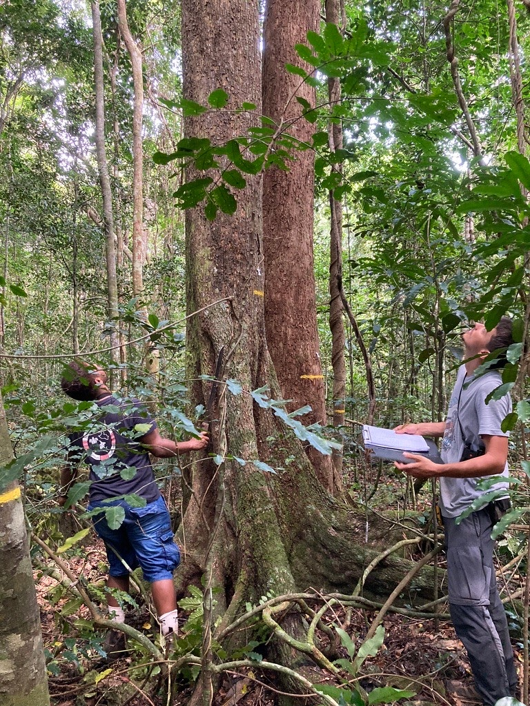{fig-alt="Two people in the forest looking up at a tall tree trunk, one holding a clipboard."}

::: {.news-text}
[December 2024]{.news-date}

### New permanent plot at Siloam, New Caledonia

The MELANOBS team, together with the Environment Department of the Loyalty Islands Province and with the help of locals, set up the first 1-ha MELANOBS permanent forest plot in New Caledonia at Siloam, on the island of Lifou. See the [Siloam plot page](plots/siloam.qmd).
:::
:::

::: {.news-item}
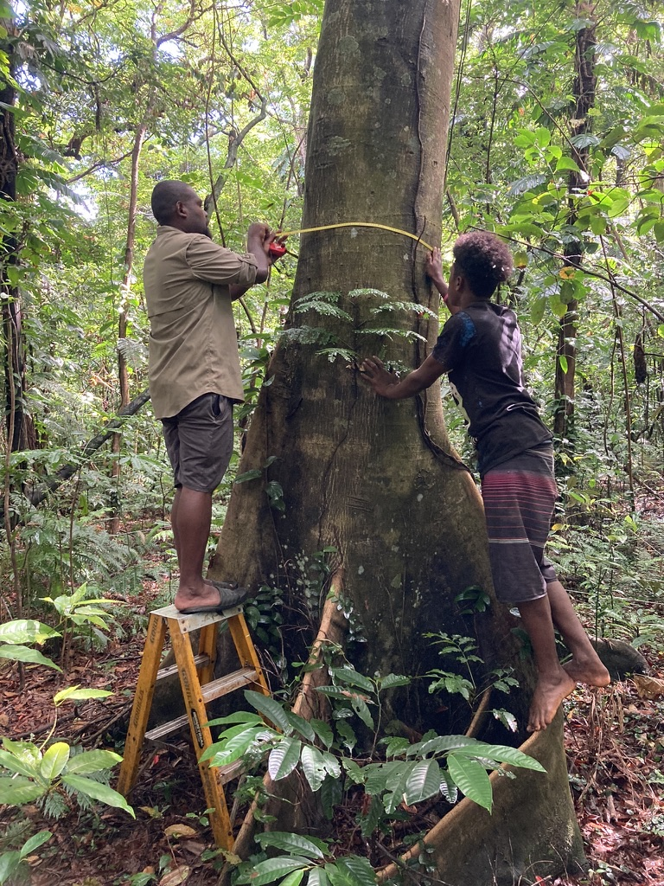{fig-alt="Two people measuring the trunk of a large buttressed tree with a tape, one standing on a stepladder."}

::: {.news-text}
[November 2024]{.news-date}

### First permanent plot at Nusumetu, Vanuatu

The MELANOBS team, together with the Vanuatu Department of Forestry and with the great help of the Nusumetu community, set up the project's first 1-ha permanent forest plot at Nusumetu, on the island of Tanna, Vanuatu. See the [Nusumetu plot page](plots/nusumetu.qmd).
:::
:::

::: {.news-item}
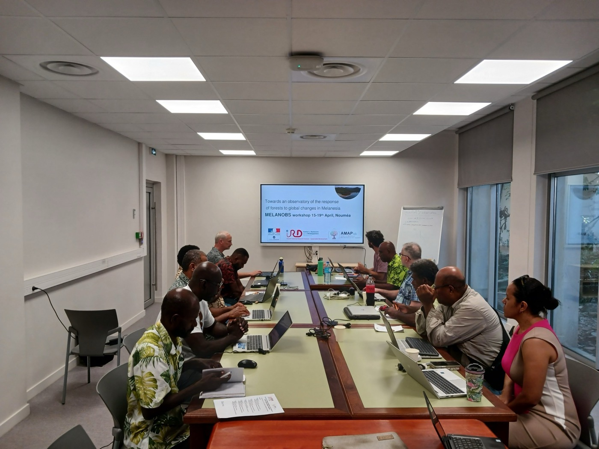{fig-alt="MELANOBS partners working on laptops around a meeting table, with the workshop title slide on a screen."}

::: {.news-text}
[April 2024]{.news-date}

### Kick-off workshop in New Caledonia

Partners from across Melanesia and beyond spent a week together in Nouméa, New Caledonia (15–19 April 2024), to co-design and launch the MELANOBS network.
:::
:::
