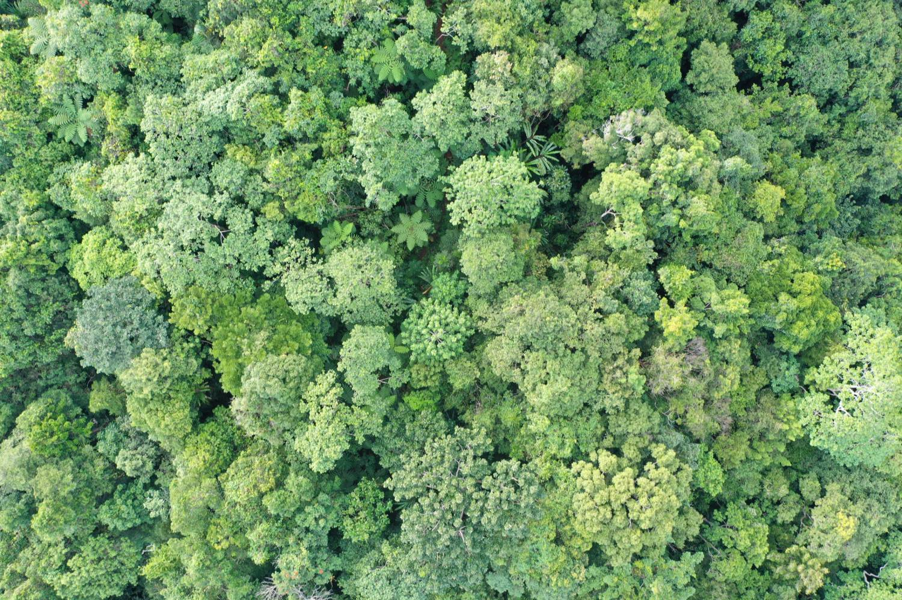

<!-- To add an item, copy a block below and paste it at the top of the list (newest first). The photo line is optional. -->

::: {.news-item}
{fig-alt="Aerial view of a dense green forest canopy."}

::: {.news-text}
[July 2026]{.news-date}

### A new permanent plot in the Vago Forest Reserve, Fiji

A 1-ha permanent plot was set up with the Fiji Ministry of Forestry in the Vago Forest Reserve, north of Suva. See the [Vago plot page](plots/vago.qmd).
:::
:::

::: {.news-item}
{fig-alt="Two people measuring the trunk of a large buttressed tree with a tape, one standing on a stepladder."}

::: {.news-text}
[November 2024]{.news-date}

### First MELANOBS permanent plot set up at Nusumetu, Vanuatu

A team from UMR AMAP in New Caledonia and the Vanuatu Department of Forestry, with the great help of the Nusumetu community, set up the project's first 1-ha permanent forest plot on Tanna. See the [Nusumetu plot page](plots/nusumetu.qmd).
:::
:::

::: {.news-item}
{fig-alt="MELANOBS partners working on laptops around a meeting table, with the workshop title slide on a screen."}

::: {.news-text}
[April 2024]{.news-date}

### Kick-off workshop in New Caledonia

Partners from across Melanesia and beyond spent a week together in Nouméa, New Caledonia (15–19 April 2024), to co-design and launch the MELANOBS network.
:::
:::
