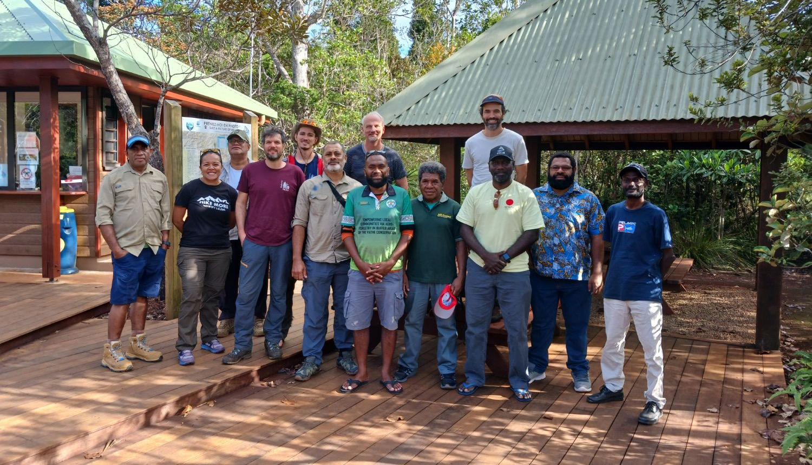

<!-- To add an item, copy a block below and paste it at the top of the list (newest first). The photo line is optional. -->

::: {.news-item}
{fig-alt="Aerial view of a dense green forest canopy."}

::: {.news-text}
[July 2026]{.news-date}

### A new permanent plot in the Vago Forest Reserve, Fiji

A 1-ha permanent plot was set up with the Fiji Ministry of Forestry in the Vago Forest Reserve, north of Suva. See the [Vago plot page](plots/vago.qmd).
:::
:::

::: {.news-item}
{fig-alt="Group photo of MELANOBS partners on a wooden deck."}

::: {.news-text}
[April 2024]{.news-date}

### Kick-off workshop in New Caledonia

Partners from across Melanesia and beyond met in New Caledonia to launch the MELANOBS network.
:::
:::
